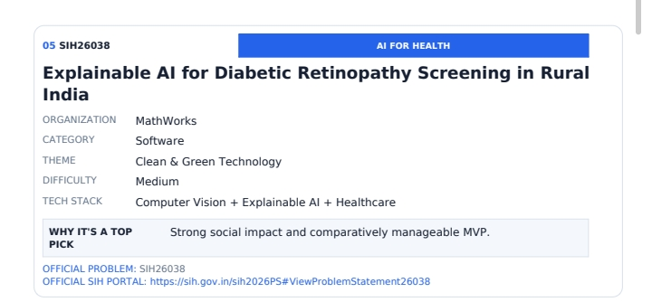
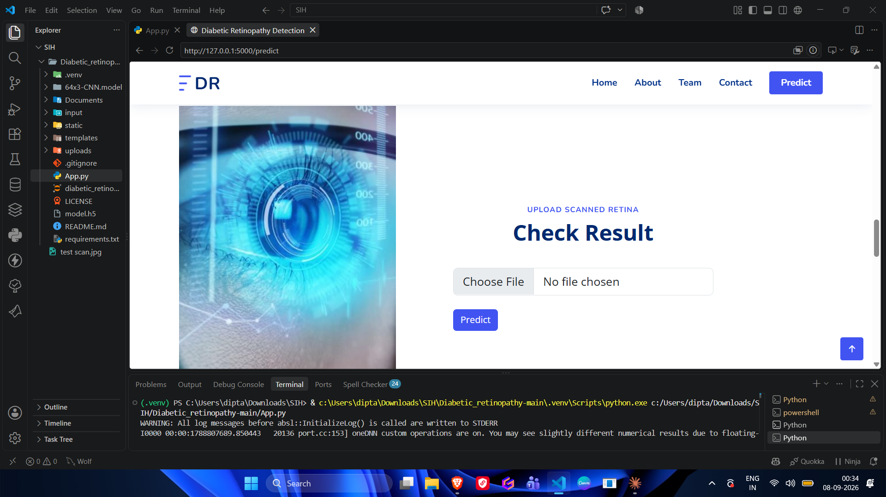
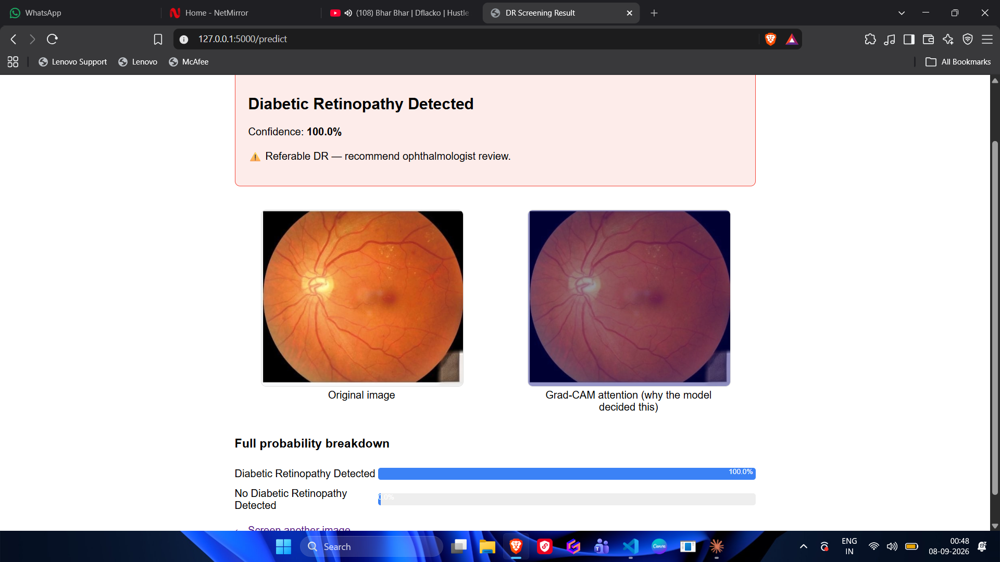
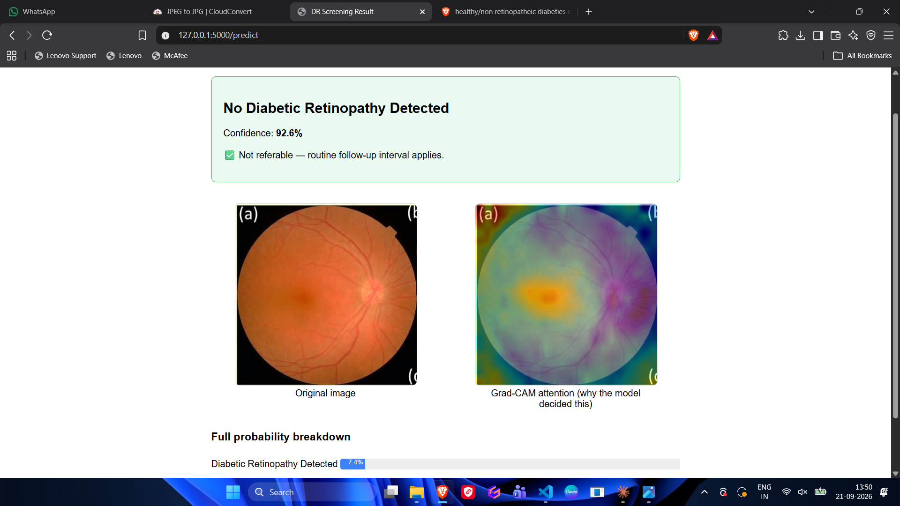
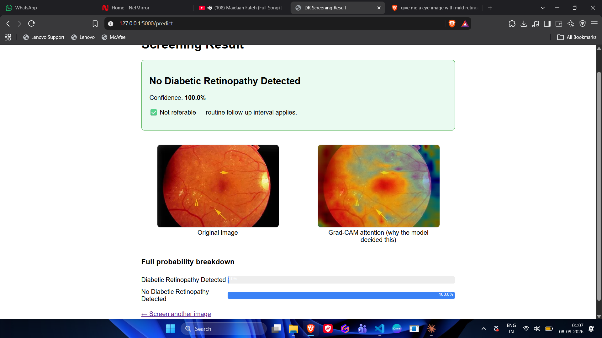
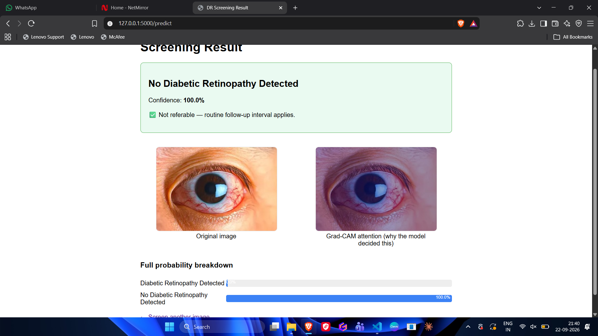

# Explainable AI for Diabetic Retinopathy Screening

**Smart India Hackathon 2026 · Problem Statement SIH26038 · Theme: AI for Health**

A web app that lets a health worker upload a retinal (fundus) photo and get an instant diabetic retinopathy (DR) prediction, with a **Grad-CAM heatmap** showing which regions of the image drove the decision, so a doctor can check the evidence instead of trusting a black box.

> ⚠️ **Research prototype.** This is a hackathon proof of concept. It is **not** a medical device and must not be used for real diagnosis or clinical decisions.

---

## Why this exists

Diabetic retinopathy damages the retina quietly, often with no symptoms until the damage is advanced. Early screening is what prevents blindness, but specialist access in rural India is limited. Our goal is to put a first-line screening checkpoint in the hands of a community health worker, at the point of care, with output a doctor can verify quickly.

<p align="center">
  
</p>

---

## What it does

- Upload a fundus image through a browser.
- The CNN classifies it and returns a prediction with a confidence score.
- A **referable / not referable** banner summarizes the result (referable = Level 2 and above on the International Clinical DR scale).
- A **Grad-CAM overlay** is generated on top of the original image: warm colors (red/yellow) mark regions that influenced the prediction most, cool colors (blue/green) mark regions that barely mattered.
- A full per-class probability breakdown is shown.

---

## Screenshots

### Upload page
<p align="center">
  
</p>

### Result with Grad-CAM explanation: DR detected
<p align="center">
  
</p>

### Result with Grad-CAM explanation: healthy retina
<p align="center">
  
</p>

---

## How it works

```
Fundus image  →  Preprocess (224×224, normalize)  →  CNN classifier
                                                         │
                                         ┌───────────────┴───────────────┐
                                         ▼                               ▼
                               Prediction + confidence        Grad-CAM heatmap
                                         └───────────────┬───────────────┘
                                                         ▼
                                       Result page (banner + overlay + probabilities)
```

**Grad-CAM in one paragraph:** the model's last convolutional layer still keeps spatial information. We compute how strongly the final prediction depends on each spatial location in that layer (via gradients), average those into per-channel weights, combine the feature maps with those weights, and upscale the result into a heatmap over the original image. It shows *where the model looked*, not whether that was the right place to look.

---

## Tech stack

| Layer | Tools |
|---|---|
| Model | TensorFlow / Keras CNN (`model.h5`) |
| Explainability | Grad-CAM (custom implementation, `tf.GradientTape`) |
| Image handling | OpenCV, NumPy |
| Backend | Flask |
| Frontend | HTML/CSS/JS (Bootstrap-based template) |

---

## Getting started

Tested on Windows with Python 3.13.

```powershell
# 1. Clone or download the project, then enter the folder
cd Diabetic_retinopathy-main

# 2. Create and activate a virtual environment
python -m venv .venv
.venv\Scripts\Activate.ps1

# 3. Install dependencies
pip install tensorflow flask opencv-python numpy werkzeug

# 4. Run the app
python app.py
```

Then open **http://127.0.0.1:5000** in your browser, scroll to **Upload Scanned Retina**, choose a fundus image, and click **Predict**.

**Notes**
- `model.h5` must be the real file (several MB), not a Git LFS pointer. If the app fails to load it, re-download the raw file from GitHub.
- The first startup takes a while because TensorFlow loads.
- Uploaded images are saved to `uploads/` and Grad-CAM overlays to `static/gradcam/`. Neither folder is cleaned automatically.

---

## Project structure

```
.
├── app.py               # Flask app, model loading, Grad-CAM, routes
├── model.h5             # Trained Keras model
├── templates/
│   ├── index.html       # Landing + upload page
│   └── predict.html     # Result page
├── static/              # CSS, JS, images, generated Grad-CAM overlays
├── uploads/             # Uploaded scans
├── Documents/images/         # README screenshots
├── LICENSE
└── README.md
```

---

## Current status and known limitations

We want to be upfront about where this stands.

**Working today**
- End-to-end pipeline: upload → prediction → Grad-CAM overlay → result page.
- Correct handling of clear healthy fundus images in our informal tests.

**Known limitations (found through our own testing)**
1. **Binary model, not 5-level grading.** The current model outputs *DR / No DR*. Full grading on the 0–4 International Clinical DR scale is not trained yet. The app adapts automatically if a 5-class model is dropped in.
2. **Misses subtle disease.** On a mild-DR example, the model predicted "No DR" with very high confidence (a false negative). In screening, this is the most important failure mode.
3. **Poorly calibrated confidence.** Some predictions show ~100% confidence even when wrong.
4. **No input validation.** The model will confidently classify images that are not fundus photos at all (see below). There is no "is this a fundus image?" check and no blur/glare quality gate yet.
5. **No clinical validation.** We have not yet measured sensitivity/specificity on a labeled test set. The base repository reports >91% test accuracy; we have not independently verified this.

<details>
<summary><b>Test cases that exposed these limitations</b></summary>

**Mild DR example predicted as "No DR" at 100% confidence**
<p align="center">
  
</p>

**A normal external eye photo (not a fundus image) classified with 100% confidence**
<p align="center">
  
</p>

</details>

---

## Roadmap

Aligned with the SIH26038 problem statement:

- [ ] **Image quality assessment:** blur, illumination, field-of-view checks, plus a "not a fundus image" rejection, with recapture feedback
- [ ] **Adaptive enhancement:** CLAHE, illumination normalization, denoising for borderline images
- [ ] **Structure segmentation:** optic disc/fovea, vessels, microaneurysms, exudates, hemorrhages, neovascularization
- [ ] **5-level severity grading** (0–4) with target >90% sensitivity and >85% specificity for referable DR
- [ ] **Calibrated confidence scores** and lesion-level evidence alongside Grad-CAM
- [ ] **MATLAB implementation** using the toolboxes named in the problem statement (Image Processing, Computer Vision, Deep Learning, Medical Imaging, Statistics and Machine Learning)
- [ ] **Simulink workflow model** of the telemedicine pipeline (acquisition rate, bandwidth, processing throughput, review capacity) for district-scale programs of 100,000+ patients per year
- [ ] **Offline-capable deployment** for low-connectivity settings

---

## Team

| Name | Role |
|---|---|
| Anant Singh | Research & Pitch Strategy |
| Priyanshi Mishra | Presentation & QA Testing |
| Diptanshu Ghosh | Lead Developer & Presentation |
| Akshita Sharnagat | Research & Pitch Strategy |
| Paramveer Singh | Software Developer |
| Jaivardhan Rai | Presentation Design |

*Bharati Vidyapeeth, Pune*

---

## Acknowledgements

- This prototype is built on top of the open-source [Cyber-Aju/Diabetic_retinopathy](https://github.com/Cyber-Aju/Diabetic_retinopathy) project (Flask + CNN baseline, web template, and trained model). We extended it with Grad-CAM explainability, adaptive class handling, and an updated results interface for SIH26038. Thanks to the original authors.
- Web template: [FlexStart](https://bootstrapmade.com/flexstart-bootstrap-startup-template/) by BootstrapMade.
- Grad-CAM: Selvaraju et al., *Grad-CAM: Visual Explanations from Deep Networks via Gradient-based Localization*.

## License

The base project is released under the MIT License. See [LICENSE](LICENSE).
